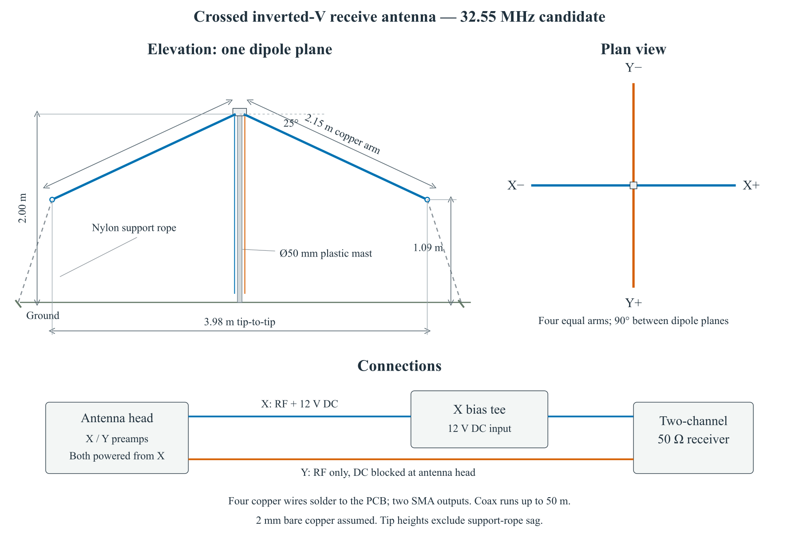
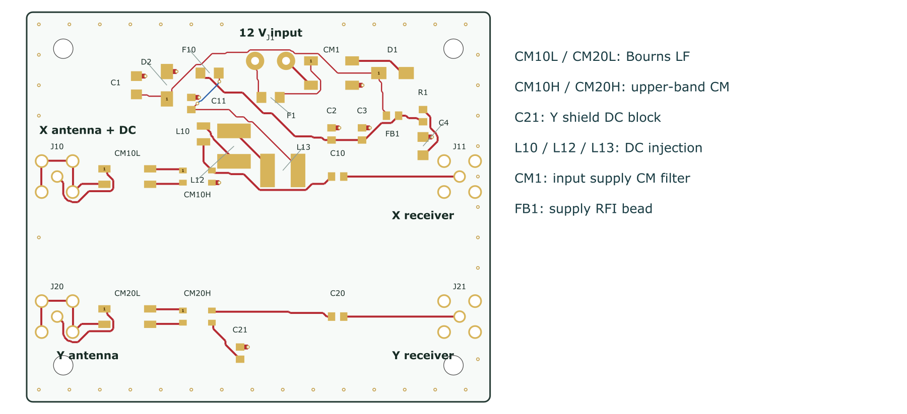

# Open antenna designs

**TL;DR:** Open-source antenna hardware designs aimed at high performance. We hope anyone can take a design, make the changes they need, and have the boards assembled by a turn-key manufacturer.

| Design | Intended use | Status |
| --- | --- | --- |
| [VHF meteor-radar antenna](vhf/) | Crossed dipoles, independent X/Y outputs; 30–55 MHz electronics, arm lengths selected for the radar frequency | Engineering prototype; modeled sensitivity and fabrication files available |
| [HF active antenna](hf/) | Balanced high-impedance input; nominal 0.1–30 MHz | Development prototype; sensitivity and linearity not yet qualified |

Both designs use 50 Ω coax outputs, a 12 V bias tee and common-mode filtering. The HF input architecture differs from the approximately 50 Ω VHF input.

## VHF example

**VHF indoor bias tee — power injection and filtering at the receiver.**

## HF example

**HF indoor bias tee — separate low-frequency common-mode filtering.**

The design folders contain the schematics, PCB layouts, simulation results and manufacturing guidance. Shared [mechanical designs](mechanical/), [modeling code](simulation/) and [CAD generators](hardware/) are kept at the repository root.

[NEC impedance models](models/nec/) cover 1 m, 1.5 m and 2 m arms from 0.1 to 150 MHz in 0.05 MHz steps, with complex X/Y feedpoint impedance in HDF5.

These are open engineering prototypes, not certified products. Simulation and CAD checks do not replace RF measurements of assembled boards. No manufacturing order has been placed. The five-set VHF electronics budget is $70–100 per set including the bias tee, excluding coax, mast, enclosure, tax and shipping; this is an estimate, not a supplier quote.

## KiCad version for collaboration

Use **KiCad 10.0.x stable** for these designs. Nico uses 10.0.5; local validation used 10.0.8. KiCad documents point releases as file-compatible. Avoid saving shared files with a newer major version or a nightly build until the team agrees to migrate. Project-local symbols and footprints are included; retain `sym-lib-table`, `fp-lib-table` and the adjacent library directories when copying a design.

`main` is the integrated working version: VHF and HF designs, retained common-mode filtering, and Nico's reviewed VHF hierarchy/coupling updates. `pfeffer-review` remains Nico's review branch.

## Component choices

**G/T and the ability to deploy more receivers are the priorities.** Spend where it improves useful antenna gain relative to system noise temperature, blocker tolerance and reliability; keep the assembled station affordable. Preferred manufacturers are a starting point, not a requirement to buy premium parts everywhere. Lower-cost filter options may trade up to 1 dB additional passband ripple and approximately 10% shift in the −3 dB edge, provided the radar frequency remains usable, FM rejection and linearity remain sufficient, and the complete noise budget passes. These are comparison allowances, not demonstrated performance or automatic acceptance limits. See the [component selection criteria](vhf/docs/ENGINEERING.md#component-selection-and-cost-tradeoffs).

## Low-cost SMA connectors

Both boards use standard-polarity **50 Ω female SMA**, factory assembled: XUNPU **SMA-KE-347A-H13.5-P (C5723187)** underneath the antenna head, and **SMA-KWE-323C-H13X23-LW (C5723201)** for horizontal bias-tee entry. Amphenol parts are no longer selected. Both have JLC wave-solder assembly listings; order-specific inventory, price and placement still need acceptance. The bias case has been updated for the XUNPU dimensions and checked for insertion of the populated board.

At the checked distributor quantity-10 prices, the six SMA connectors total approximately **$5.89 per set** (2 × $0.3881 + 4 × $1.2773). This excludes assembly and is not a complete-board quote. [Selection, drawings and pricing scope](hardware/connector_selection.json).
