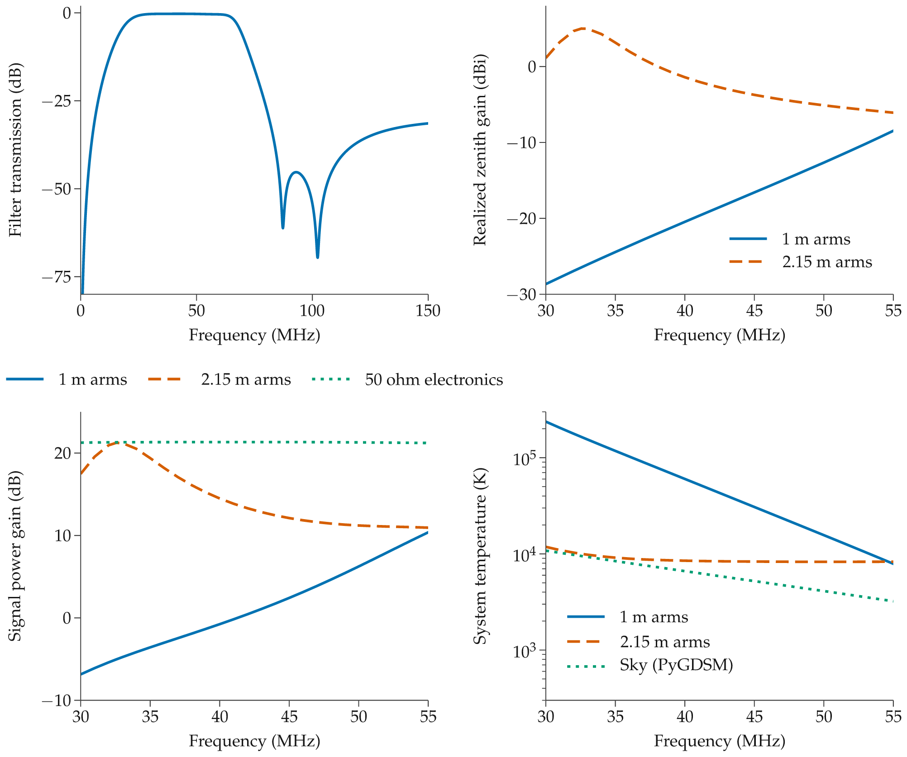
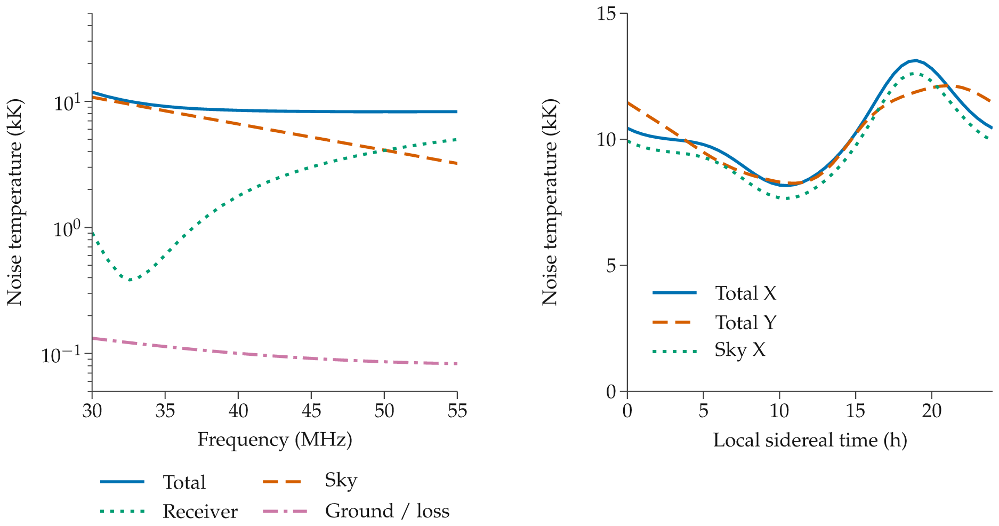
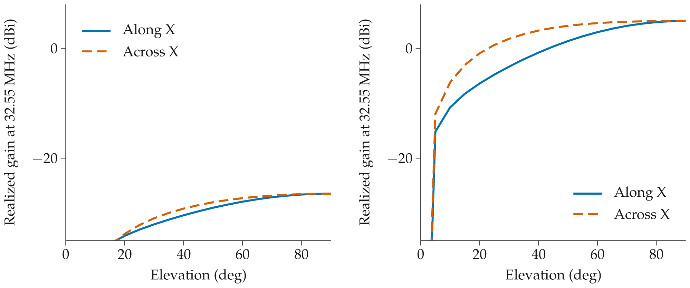
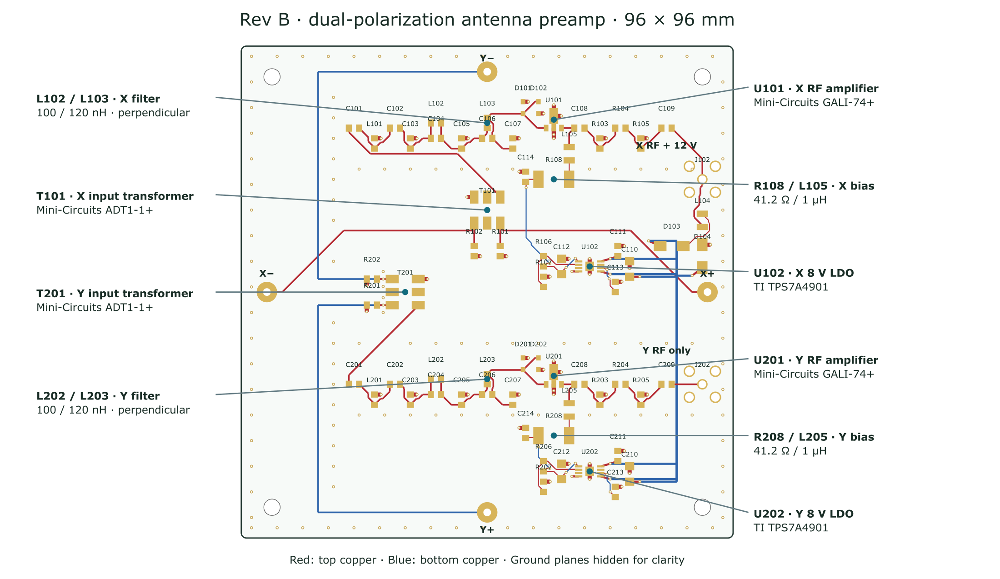
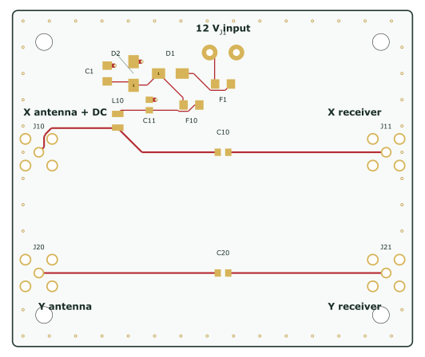
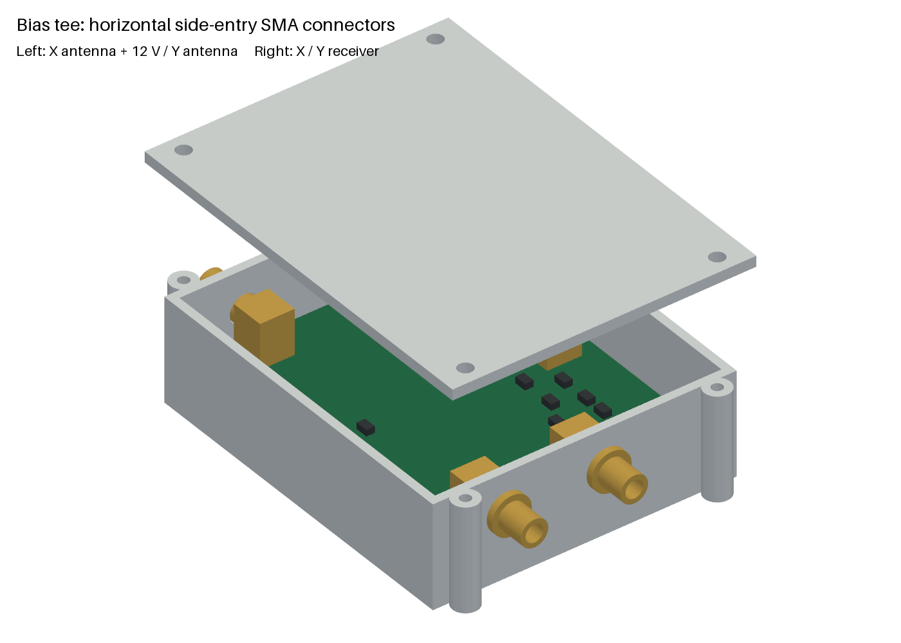
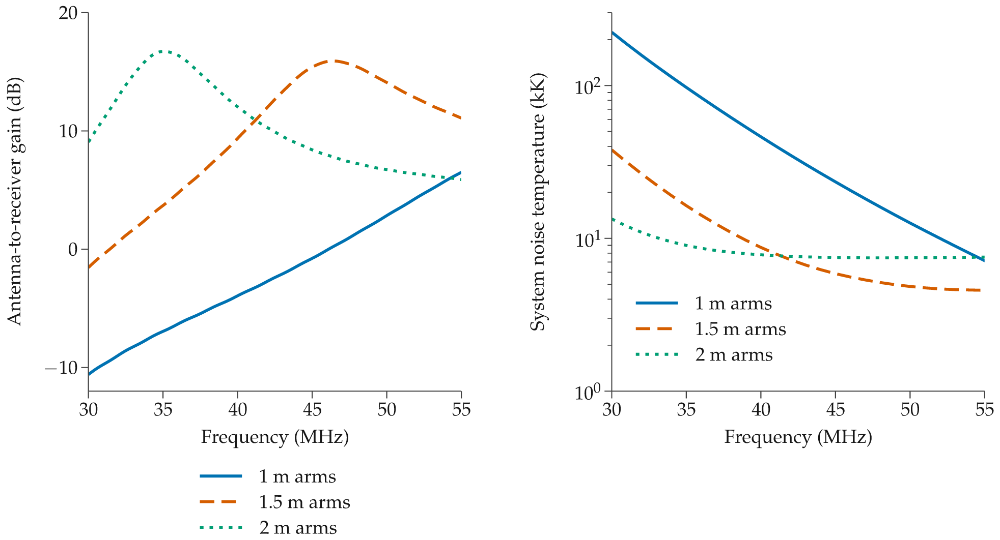
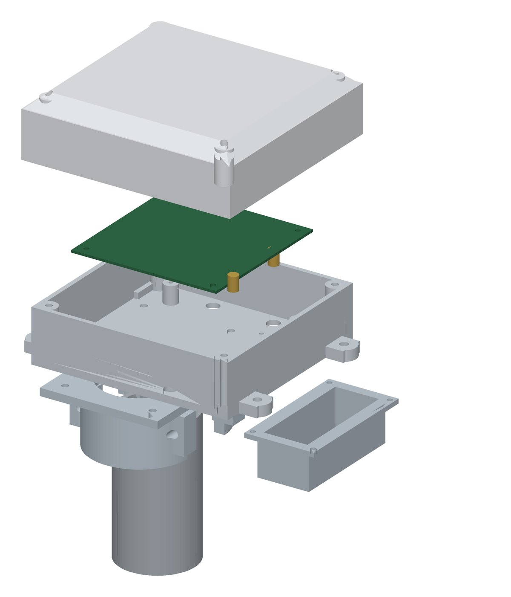
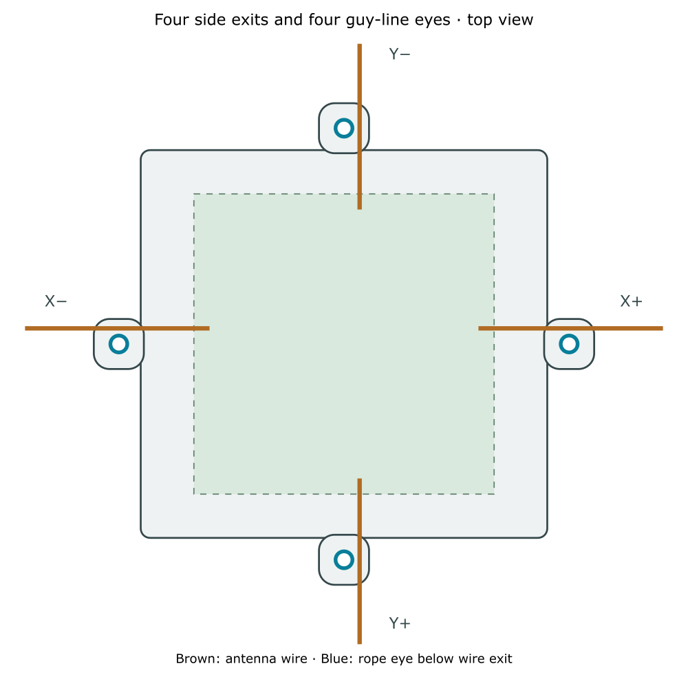
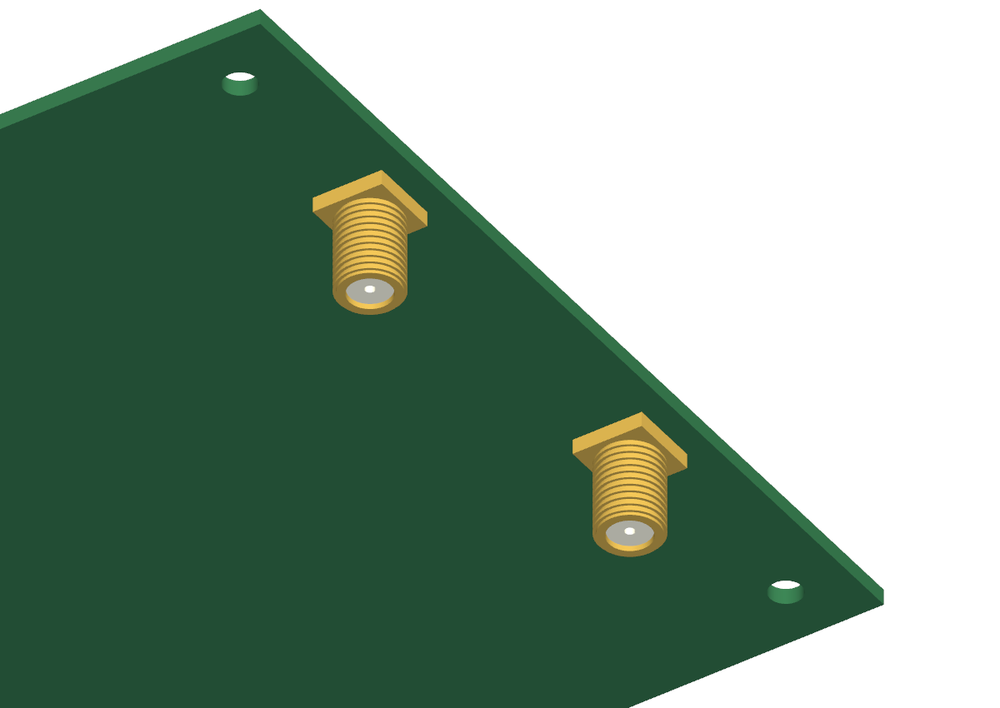

# Metantenna — X/Y meteor-radar receive antenna

**TL;DR:** two independent linear-polarization channels, four soldered copper
antenna arms, and two 50 Ω SMA outputs. **Only X carries 12 V DC**, powering both
preamps. The current filter targets **30–55 MHz**, with stronger FM suppression.
The modeled SIMONe 32.55 MHz deployment uses **2.15 m arms,
25° downward slope and a 2 m plastic mast**.

**Engineering prototype:** simulated results and datasheet-based budgets are
shown below. Complete-system RF, weather and installation tests are outstanding;
the fabrication files are prototype files. No manufacturing order has been placed.

**Rev B prototype manufacturing:** native KiCad electrical/clearance and
schematic-parity checks pass. The [JLCPCB package and order instructions](manufacturing/JLC_ORDER.md)
include separate BOM/CPL files and hand-installed connector lists. Exact part
matching, placement preview and manufacturer CAM acceptance remain required
before payment; this is not measured RF qualification.

[Download the complete Rev B JLCPCB package](manufacturing/metantenna_rev_b_jlc_package.zip)
— five preamp boards and five bias-tee boards.

## Deployment

Four equal bare copper arms attach directly to symmetric PCB solder pads.
Use housing strain relief and nylon support ropes. The modeled wire diameter
is 2 mm; the selected geometry has approximately 1.09 m tip clearance and a
3.98 m footprint across each dipole. X and Y are orthogonal linear feeds;
circular polarization can be formed with calibrated coherent receiver channels.
[Download the deployment PDF](docs/antenna_deployment.pdf).

**The original 1 m arms / 45° / 1 m mast arrangement is poorly matched at
32.55 MHz:** about 26 dB loss into this 50 Ω input. It would require a different
input design for good sensitivity at that frequency. Longer arms improve the
32.55 MHz match, but do not make antenna gain flat across the entire band.

## Expected performance at 32.55 MHz

Values below refer to the longer-arm candidate and one linear polarization.
They are predictions, not measured production specifications.

| Quantity | Expected value | Basis |
|---|---:|---|
| Realized antenna gain toward zenith | **5.0 dBi** | NEC2, including 50 Ω mismatch |
| Antenna impedance | **61 − j7 Ω** | NEC2 |
| Antenna-head electronic power gain | **21.2 dB** | Filter model + amplifier budget; before coax |
| System noise temperature, median | **10.0 kK** | PyGDSM sky + ground + receiver |
| System noise over a sidereal day | **8.2–13.1 kK** | Same model, representative German latitude |
| Receiver contribution, antenna-referred | **384 K** | Includes assumed 50 m coax and receiver |
| Output IP3 / input IP3 | **+35 / +13.8 dBm** | Typical-device extrapolation |
| Output / input 1 dB compression | **+16.2 / -5.0 dBm** | Typical-device extrapolation |
| Two-tone SFDR in 100 kHz | **82 dB** | Estimated against the modeled sky + receiver noise |
| DC supply | **12 V, about 0.16 A total** | Both channels, via X coax only |

IP3 and compression are estimates from [GALI-74+ manufacturer typical values
at 100 MHz](https://www.minicircuits.com/pdfs/GALI-74.pdf), extrapolated to this
band. Balun linearity, pulse recovery, blockers and the following receiver may
limit the installed system. The passive wire antenna itself has no amplifier IP3.

## Band response and FM rejection

The filter plot covers **DC–150 MHz**. DC is blocked and lies below the plotted
−80 dB floor. Nominal loss across 30–55 MHz is at most
**0.38 dB**. The weakest FM rejection
anywhere in 88–108 MHz is **45.3 dB nominally**,
and **42.5 dB in the worst of 300 component-tolerance trials**.
These results assume the component-loss model; PCB coupling has not been extracted.
A conservative inductor-Q scenario gives about 1.14 dB passband loss.
[Filter detail and tolerance curves](docs/filter_response.png).

## Sky and system noise

Sky noise uses **PyGDSM GSM2016**, integrated with the NEC antenna pattern,
including the CMB. The example latitude is **54.12° N** with X east–west.
The frequency curves use sidereal-day medians; the time curves are at 32.55 MHz.
The sky contribution is shown separately, alongside the receiver and ground/loss
terms. Solar activity, interference, terrain and nearby structures are excluded.
The noise model uses a first-order 50 Ω mismatch approximation.

## Antenna gain pattern

Left: the requested 1 m-arm geometry. Right: the longer-arm candidate.
Both show X-port realized gain at **32.55 MHz**, along and across the X dipole
plane. Ground is included. The candidate's predicted zenith
gain ranges roughly 4–6 dBi across the soil scenarios tested.

## Boards

**Antenna head — 96 × 96 mm.** Copper arms solder to the four large edge pads.
SMA connectors are only for X/Y coax. Red traces are top copper, blue traces
bottom copper; ground planes are hidden in this view.

**Indoor board — 76 × 64 mm.** X injects bias power; Y is an RF-only pass-through.

**Indoor bias tee: horizontal side-entry SMA jacks.** J10/J20 face left
(antenna); J11/J21 face right (receiver). These are right-angle bulkhead
Amphenol 132203 jacks, not the outdoor head’s downward-facing 132134 jacks.
The indoor case has four side holes, 2 mm walls at the jacks, space for
retaining nuts, a rear 12 V cable entry, and a screw-on lid. Print
[biastee_base.stl](mechanical/stl/biastee_base.stl) and
[biastee_lid.stl](mechanical/stl/biastee_lid.stl). Fit-test a print before ordering
a batch; the connector illustration is a dimensional envelope.

## Complete signal chain and arm lengths

The 1, 1.5 and 2 m arm comparisons use the same **2 m mast and 25° downward
slope**. Gain includes the preamp, bias tee and 50 m cable; noise includes PyGDSM
sky. The amplifier is a linear behavioral model, not a transistor-level simulation.
For a matched 50 Ω source, modelled cable-inclusive gain is **15.9–17.3 dB**.
Use regulated **12 V (minimum 11.76 V)** and coax with **≤3 Ω DC loop resistance**.
[Calculation details and limits](simulation/END_TO_END.md).

## Housing and files

Rev B uses just **two printed housing parts**: a base with an integral Ø50 mm
pipe socket and downward-open connector rain skirt, plus the rain hood.
One M5 bolt passes through the socket and a drilled plastic pipe. Four side wire exits align with the antenna solder pads, beneath the hood overlap.
Each side has a structural guy-line eye directly below its wire exit; internal
nylon ties provide strain relief. Tie the guy rope to the eye, not the antenna wire.
The PCB component positions in the rendering follow Rev B (bodies are simplified).
Print the fit coupon first. Fit, drainage and weather performance need physical checks;
this is a ventilated rain-shedding housing, not an IP-rated enclosure.

- [Editable KiCad boards and schematics](hardware/)
- [Prototype Gerbers, drills and assembly workbooks](manufacturing/)
- [Printable STL files and parametric housing](mechanical/)
- [Engineering assumptions, checks, references and reproduction](docs/ENGINEERING.md)
- [Antenna model and HDF5 results](simulation/antenna/)

The electronics budget target remains **$70–100 per complete set** for the
five-set prototype batch, including the bias tee and excluding coax, mast,
enclosure, tax and shipping. This is a budget estimate, not a supplier quote.
