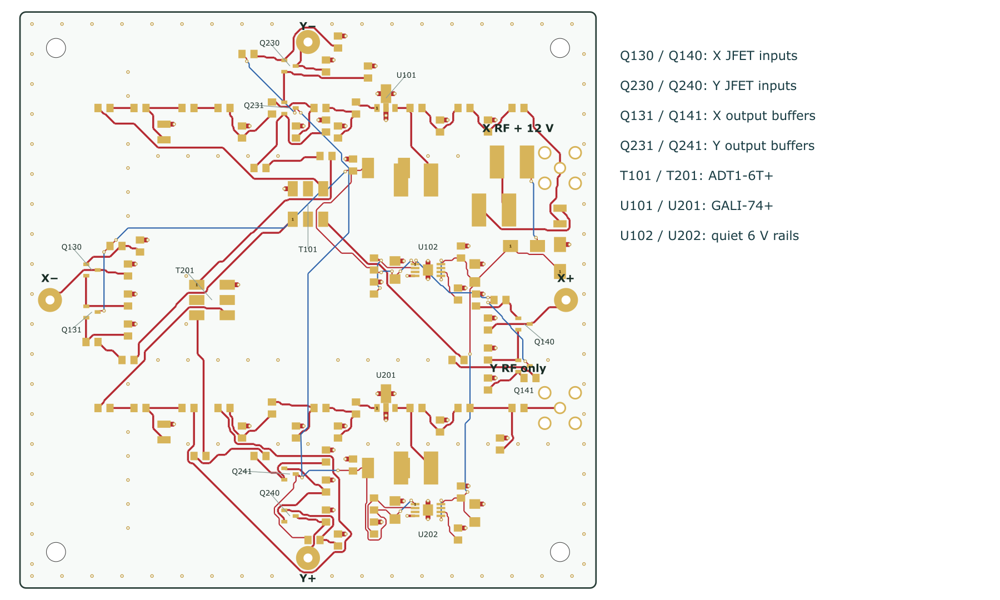
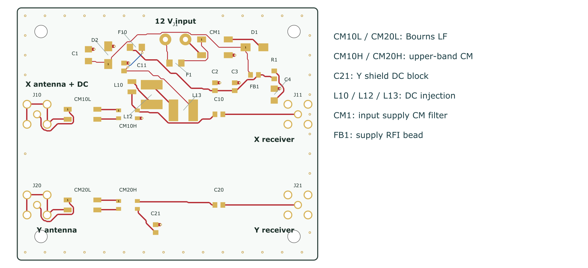

# Broadband HF active dipole — development prototype

Balanced high-impedance X/Y inputs use paired MMBFJ310 JFET followers and BC850C output buffers. The nominal passband is 0.1–30 MHz. Only the X coax carries 12 V DC; both polarizations have common-mode filtering at the indoor bias board.

**This prototype is not RF-qualified or ready to order.** Native CAD checks pass, but the complete antenna/noise target, stability, blocker linearity and installed common-mode suppression still require validation. High input resistance alone does not establish sensitivity.

## Antenna head

## Indoor bias tee

The bias tee sits beside the receiver; the amplifier sits at the antenna. Only X supplies DC, while both coax paths include common-mode filtering.

- [KiCad schematic and PCB sources](hardware/)
- [Circuit overview](frontend.pdf)
- [Simulation and noise screening](../simulation/hf/)
- [Input-stage screening](docs/hf_frontend_screening.png)
- [Common-mode choke screening](docs/hf_choke_screening.png)
- [Shared enclosure sources](../mechanical/)

Shared generators remain in [`../hardware/`](../hardware/): `build_hf.py`, `finalize_hf.py` and `check_hf_native.py`. Use base conda Python. The mechanical interfaces reuse the VHF connector positions; confirm the exact assembled parts against the case before manufacture.
