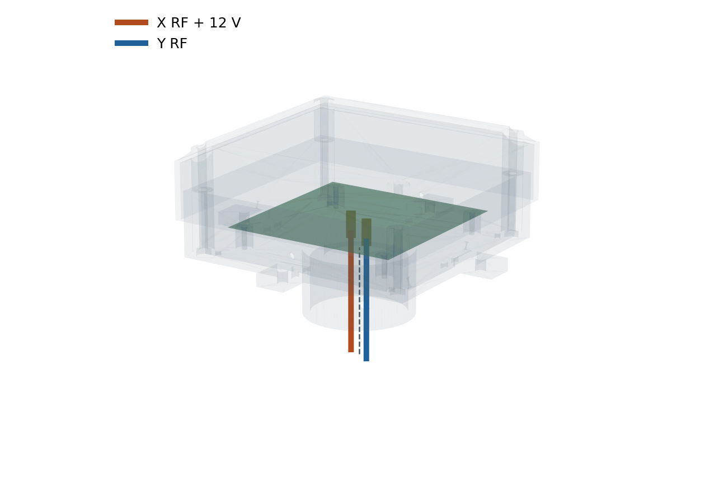

# VHF antenna head with centered SMA connectors

Both factory-assembled SMA jacks sit over the 50 mm mast socket. The enclosure mounts the PCB component-side down, so the two coax cables pass straight into the pipe. Feed the plugs through with the board lifted, connect X and Y, then lower and fasten the board. The symmetric rain hood fits the shallow base.

The case is modeled for a pipe with at least a 36 mm inner diameter and plugs up to 12 mm in diameter. The 35 mm socket is the only feature below the housing floor.

KiCad ERC, DRC, and schematic parity passed. The two rerouted output nets remain on the component-side copper layer. The longer runs require RF validation for isolation and amplifier stability. This candidate has not been uploaded to JLCPCB or physically fit-tested.

[KiCad board](hardware/preamp.kicad_pcb) · [Printable base](mechanical/stl/base.stl) · [Symmetric hood](mechanical/stl/rain_hood.stl)
