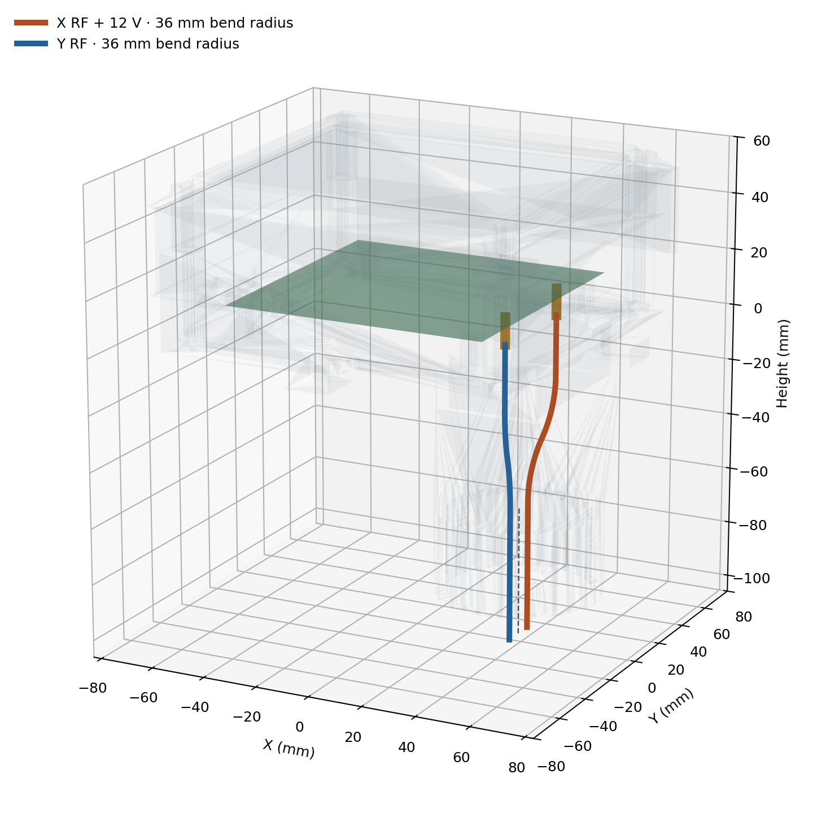

# VHF Rev B — JLCPCB sourcing revision

Five antenna heads and five bias tees. The original architecture and board outlines are retained. APV 100 nH and 1 µH inductors use their manufacturer lands. The 18 Ω resistors are locked to Yageo C137583. The output pad uses 300 Ω shunts and the amplifier uses 43 Ω, 1 W bias resistors. The RF capacitors retain C0G/NP0. Review the complete exact-MPN assembly files in the quotation archive.

Fresh native connectivity, ERC, DRC and parity checks are run by check.py. screen_local_parts.py evaluates 2,048 independent linear preselector corners and bias bounds. The simulated worst-case FM rejection is 36.1 dB and the highest modeled 43 Ω resistor dissipation is 0.35 W. The 300 Ω shunts change the ideal matched pad attenuation by about 0.03 dB. These checks do not qualify physical RF performance or cold start.

The antenna head uses single-sided assembly. Both SMA jacks mount on the component side, and the revised enclosure holds that side down so the coax exits underneath. The bias tee uses four side-entry SMA jacks and three common-mode chokes.

The symmetric rain hood uses 2 mm nominal sidewalls. Both coax cables pass through one socket beneath the SMA pair for a 50 mm OD pipe. The cable-path drawing assumes a pipe bore of at least 36 mm, 6 mm coax, and SMA mating plugs up to 12 mm in diameter. The paths shown have nominal bend radii of about 36 mm.

Fit the empty base to the pipe using the offset M5 bolt. With the hood off, feed the two SMA plugs up through the pipe and pull enough slack to connect them with the PCB above the box. Lower the PCB component-side down while taking up slack from below, then fasten the board and hood.

[Quotation package](manufacturing/vhf_jlc_sourcing_QUOTATION.zip) · [Enclosure base](mechanical/stl/base.stl)
