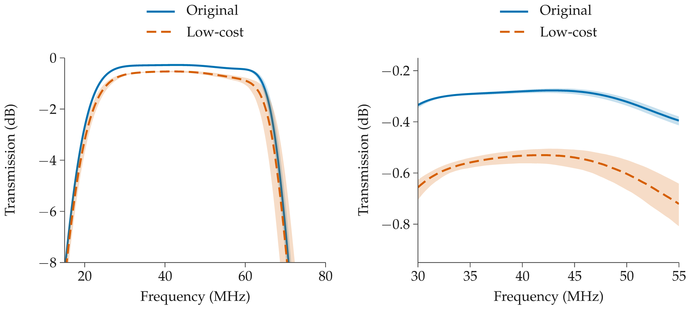

# Low-cost VHF candidate

The existing amplifier, transformers, regulators, common-mode filtering and connectors are retained. The ten inductors per complete set become APV AHW ceramic wire-wound parts; frequency-setting and 1 nF coupling capacitors become 5% Yageo C0G/NP0 parts. Do not substitute ferrite power inductors or X7R into the tuned filter. Optional BAT15 clamps remain unpopulated; no gas-discharge device is added.

APV manufacturer recommended lands are implemented as APV2012 (1.02 × 1.78 mm pads, 1.78 mm centre spacing) and APV2520 (1.02 × 2.54 mm pads, 2.29 mm centre spacing). Only X_HP, Y_HP, X_COAX and X_RAW require local routing changes. The baseline layout and sources are not overwritten. The unchanged nominal values and every connected schematic pin are checked against the baseline. Four layers and connector/case coordinates remain the same. Component body clearance and actual placement remain manufacturer review items.

The [manufacturer datasheet](https://www.apvind.com/public/upload/20250320/4fc1cd2e99a682c5cde5d3172fbe53ae.pdf) specifies Q at 250/500 MHz for the filter inductors; it does not establish Q at 30–55 MHz. Sensitivity screening therefore uses Q=20, 35 and 50 at 50 MHz and 500 independent ±5% component trials per case. The model has constant equivalent series resistance referenced to 50 MHz; PCB coupling and detailed component resonances are excluded. The nominal filter calculation agrees with an independent ngspice calculation to within 4.8e-6 in complex transmission. RF screening cannot qualify IP3, stability or surge survival.

In the Q=35 scenario, extra nominal filter loss is 0.284 dB at 32.55 MHz and 0.267 dB at 50 MHz. The worst sampled FM rejection is about 37 dB, worse than the baseline tolerance study; this matters at strong FM sites. These scenarios are not measured results or statistical production-yield predictions.

The first-order G/T comparison reuses the existing NEC/PyGDSM antenna and sky calculation. It applies the incremental passive loss to the old receiver noise contribution and adds 290 K thermal loss referred through the existing antenna power match. It does not recompute complex load/noise interactions. For the tuned SIMONe geometry, Q=35 gives a maximum daily G/T penalty of about 0.024 dB near 32.55 MHz; short mismatched arms do substantially worse. Nominal pattern/directivity is unchanged by the passive-parts substitution. Absolute Tsys/Tsky acceptance still needs the actual component and antenna configuration.

Budget: roughly $31–53 in components per complete set at five sets. This is a planning interval, not a verified BOM quotation or an assembled-board price. Every populated part has an allowance in the BOM; setup/loading fees, PCB fabrication, placement, through-hole assembly, attrition, freight/tax and testing are excluded. Catalogue codes do not establish available assembly inventory. Several capacitor codes and small-batch sourcing details remain unresolved. A $20 fully assembled set is not supported by the retained architecture: the two baluns, two amplifiers and six SMA connectors alone consume most or all of that amount at small quantities. A lower price requires a separately validated input/amplifier redesign or larger production run.

Reproduce with base conda Python: run generate.py, screen.py and check.py in this directory. Numerical comparisons are HDF5; schematic PDFs, native Gerbers and CAD check reports are in validation/. Do not order from these files before part matching, RF bench evaluation and assembly review.

## Ngspice tolerance and complex-source G/T comparison

The two assemblies were each evaluated with 500 independent ngspice tolerance draws. Original filter capacitors use ±1% and inductors ±2%; cost-down filter parts use ±5%. Both input blocking capacitors use ±5%. All deviations are sampled uniformly and independently. Q is held at the assumed 50 MHz value of 70 or 35 respectively; additional nominal Q=20 and Q=50 cases bound sensitivity to that assumption. These are engineering scenarios, not a measured production distribution.

Lines show median transmission and shaded areas the central 95% of the assumed draws. The common 0.5 dB balun loss is removed from this transmission display. The −3 dB edges are measured relative to each response maximum. Central 95% upper-edge ranges are approximately 67.0–68.2 MHz (original) and 65.4–69.0 MHz (cost-down). At 32.55 MHz, filter transmission loss is approximately 0.30 versus 0.59 dB; at 50 MHz, 0.32 versus 0.60 dB. The central 95% response width anywhere in 30–55 MHz is at most approximately 0.035 versus 0.167 dB under these fixed-Q scenarios.

G/T change is low-cost minus original: negative values are worse. Each curve summarizes a sidereal-day median; bands reflect paired independent component-tolerance draws. Arm lengths are per arm, with the same 2 m feed height and 25-degree downward slope. At 32.55 MHz, nominal changes for 1, 1.5 and 2 m arms are approximately −0.60, −0.41 and −0.048 dB; at 50 MHz, approximately −0.37, −0.051 and −0.22 dB. The separately tuned 2.15 m SIMONe geometry gives approximately −0.020 dB at 32.55 MHz. Its nominal Q sensitivity is approximately −0.053 to −0.008 dB for the Q=20 to Q=50 cases.

This supersedes the earlier incremental-noise approximation for these comparisons. Both directions of the passive network are solved in ngspice. Thermal-noise correlations are calculated as C = 290(I − SSᴴ), and combined with the actual complex NEC source reflection. The matched attenuator/Friis and lossless-network limits are checked. PyGDSM sky, ground contribution and NEC directional gain are reused. The G/T reference is available antenna gain and antenna-referred system temperature, avoiding a second mismatch penalty.

The unchanged amplifier is assumed matched and unilateral, with 25.1 dB gain and 2.7 dB noise figure extrapolated from 100 MHz; vendor noise parameters, reverse noise correlations, PCB coupling and measured component losses are unavailable. Antenna patterns and the orthogonal-port load are held fixed. This is not a full electromagnetic/noise-parameter qualification. A poor baseline antenna match can make added receiver noise important: a small penalty for tuned arms does not validate short arms everywhere.

[HDF5 numerical results](../simulation/spice_tolerance/results.h5), [summary and assumptions](../simulation/spice_tolerance/summary.json), and nominal circuit decks are available for review. No current production CAD or BOM was changed by this simulation.
