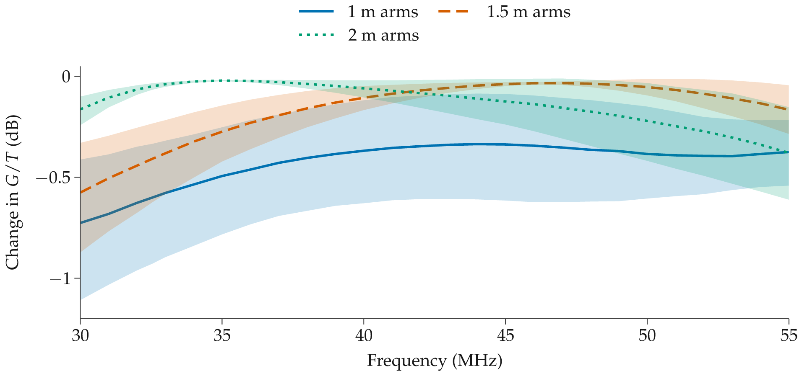

# Low-cost VHF candidate

The existing amplifier, transformers, regulators, common-mode filtering and connectors are retained. The ten inductors per complete set become APV AHW ceramic wire-wound parts; frequency-setting and 1 nF coupling capacitors become 5% Yageo C0G/NP0 parts. Do not substitute ferrite power inductors or X7R into the tuned filter. Optional BAT15 clamps remain unpopulated; no gas-discharge device is added.

APV manufacturer recommended lands are implemented as APV2012 (1.02 × 1.78 mm pads, 1.78 mm centre spacing) and APV2520 (1.02 × 2.54 mm pads, 2.29 mm centre spacing). Only X_HP, Y_HP, X_COAX and X_RAW require local routing changes. The baseline layout and sources are not overwritten. The unchanged nominal values and every connected schematic pin are checked against the baseline. Four layers and connector/case coordinates remain the same. Component body clearance and actual placement remain manufacturer review items.

The [manufacturer datasheet](https://www.apvind.com/public/upload/20250320/4fc1cd2e99a682c5cde5d3172fbe53ae.pdf) specifies Q at 250/500 MHz for the filter inductors; it does not establish Q at 30–55 MHz. Sensitivity screening therefore uses Q=20, 35 and 50 at 50 MHz and 500 independent ±5% component trials per case. The model has constant equivalent series resistance referenced to 50 MHz; PCB coupling and detailed component resonances are excluded. The nominal filter calculation agrees with an independent ngspice calculation to within 4.8e-6 in complex transmission. RF screening cannot qualify IP3, stability or surge survival.

In the Q=35 scenario, extra nominal filter loss is 0.284 dB at 32.55 MHz and 0.267 dB at 50 MHz. The worst sampled FM rejection is about 37 dB, worse than the baseline tolerance study; this matters at strong FM sites. These scenarios are not measured results or statistical production-yield predictions.

The first-order G/T comparison reuses the existing NEC/PyGDSM antenna and sky calculation. It applies the incremental passive loss to the old receiver noise contribution and adds 290 K thermal loss referred through the existing antenna power match. It does not recompute complex load/noise interactions. For the tuned SIMONe geometry, Q=35 gives a maximum daily G/T penalty of about 0.024 dB near 32.55 MHz; short mismatched arms do substantially worse. Nominal pattern/directivity is unchanged by the passive-parts substitution. Absolute Tsys/Tsky acceptance still needs the actual component and antenna configuration.

Budget: roughly $31–53 in components per complete set at five sets. This is a planning interval, not a verified BOM quotation or an assembled-board price. Every populated part has an allowance in the BOM; setup/loading fees, PCB fabrication, placement, through-hole assembly, attrition, freight/tax and testing are excluded. Catalogue codes do not establish available assembly inventory. Several capacitor codes and small-batch sourcing details remain unresolved. A $20 fully assembled set is not supported by the retained architecture: the two baluns, two amplifiers and six SMA connectors alone consume most or all of that amount at small quantities. A lower price requires a separately validated input/amplifier redesign or larger production run.

Reproduce with base conda Python: run generate.py, screen.py and check.py in this directory. Numerical comparisons are HDF5; schematic PDFs, native Gerbers and CAD check reports are in validation/. Do not order from these files before part matching, RF bench evaluation and assembly review.

## Ngspice tolerance and complex-source G/T comparison

The two assemblies were each evaluated with 500 independent ngspice tolerance draws. Original filter capacitors use ±1% and inductors ±2%; cost-down filter parts use ±5%. Both input blocking capacitors use ±5%. All deviations are sampled uniformly and independently. Q is held at the assumed 50 MHz value of 70 or 35 respectively; additional nominal Q=20 and Q=50 cases bound sensitivity to that assumption. These are engineering scenarios, not a measured production distribution.

Lines show median transmission and shaded areas the central 95% of the assumed draws. The common 0.5 dB balun loss is removed from this transmission display. The −3 dB edges are measured relative to each response maximum. Central 95% upper-edge ranges are approximately 67.0–68.2 MHz (original) and 65.4–69.0 MHz (cost-down). At 32.55 MHz, filter transmission loss is approximately 0.30 versus 0.59 dB; at 50 MHz, 0.32 versus 0.60 dB. The central 95% response width anywhere in 30–55 MHz is at most approximately 0.035 versus 0.167 dB under these fixed-Q scenarios.

G/T change is low-cost minus original: negative values are worse. Each curve summarizes a sidereal-day median; bands reflect paired independent component-tolerance draws. Arm lengths are per arm, with the same 2 m feed height and 25-degree downward slope. At 32.55 MHz, nominal changes for 1, 1.5 and 2 m arms are approximately −0.60, −0.41 and −0.048 dB; at 50 MHz, approximately −0.37, −0.051 and −0.22 dB. The separately tuned 2.15 m SIMONe geometry gives approximately −0.020 dB at 32.55 MHz. Its nominal Q sensitivity is approximately −0.053 to −0.008 dB for the Q=20 to Q=50 cases.

This supersedes the earlier incremental-noise approximation for these comparisons. Both directions of the passive network are solved in ngspice. Thermal-noise correlations are calculated as C = 290(I − SSᴴ), and combined with the actual complex NEC source reflection. The matched attenuator/Friis and lossless-network limits are checked. PyGDSM sky, ground contribution and NEC directional gain are reused. The G/T reference is available antenna gain and antenna-referred system temperature, avoiding a second mismatch penalty.

The unchanged amplifier is assumed matched and unilateral, with 25.1 dB gain and 2.7 dB noise figure extrapolated from 100 MHz; vendor noise parameters, reverse noise correlations, PCB coupling and measured component losses are unavailable. Antenna patterns and the orthogonal-port load are held fixed. This is not a full electromagnetic/noise-parameter qualification. A poor baseline antenna match can make added receiver noise important: a small penalty for tuned arms does not validate short arms everywhere.

[HDF5 numerical results](../simulation/spice_tolerance/results.h5), [summary and assumptions](../simulation/spice_tolerance/summary.json), and nominal circuit decks are available for review. No current production CAD or BOM was changed by this simulation.

## Temperature target: −50 to +30 °C

The requested outdoor operating target is −50 to +30 °C, including cold start. Neither assembly is currently qualified for that complete interval. The selected APV AHW-C inductors specify −40 to +85 °C, the original Coilcraft 0805HP specifies −40 to +125 °C, and the common TPS7A4901 regulator specifies −40 to +125 °C. Storage limits are not operating guarantees. Self-heating does not establish successful cold start.

Both tuned-capacitor choices use C0G/NP0, whose class temperature coefficient is 0 ±30 ppm/°C. That corresponds to at most approximately 0.24% change across an 80 °C span for a constant limiting coefficient. Coilcraft publishes +100 to +250 ppm/°C inductance coefficient for 0805HP; the reviewed APV AHW-C sheet does not give an equivalent coefficient. Therefore a quantitative cheap-versus-expensive temperature-stability comparison cannot be established from these data.

An ngspice LC-drift-only screen applies the Coilcraft coefficient endpoints and capacitor coefficient endpoints at −50 and +30 °C relative to 25 °C. Loss/Q, resistor values, capacitor ESR/ESL, amplifier bias/noise and common-mode filter parameters are held fixed. The −50 °C curves are an explicit extrapolation outside component operating specifications, not evidence of operation there. The approximate full-span frequency shift from f ∝ 1/sqrt(LC) is 0.28–1.12%, about 0.19–0.75 MHz for an upper edge near 67 MHz. These figures cannot be assigned to the APV inductors without their TCL or measurement.

[Numeric drift screen](../simulation/temperature/summary.json) and HDF5 are retained. Source specifications: [Coilcraft 0805HP](https://www.coilcraft.com/getmedia/c30565bc-9cf5-4393-9380-6f782e4b4cd8/0805hp.pdf), [APV AHW-C](https://www.apvind.com/public/upload/20250320/4fc1cd2e99a682c5cde5d3172fbe53ae.pdf), and [TI TPS7A49](https://www.ti.com/lit/ds/symlink/tps7a49.pdf). The low-cost prototype remains reasonable for evaluation; cold-start, gain/noise and filter measurements at the required extremes are needed before claiming that operating range.

## Selective upgrade within the additional $5 per set

The current candidate retains Coilcraft 0805HP-221XGRC at L101/L201 and 0805HP-121XGRC at L103/L203. L102/L202 remain APV 100 nH. Cheap C0G capacitors, power components, SMA connectors and both common-mode filters are retained. No baseline or HF hardware is changed.

An eight-way nominal ngspice screen compares every combination of the three inductor pairs, retaining the complex NEC source impedance and existing PyGDSM sky model. The chosen 220 nH + 120 nH combination gives a useful compromise across 32.55–55 MHz and the modeled arm lengths. Assumed Q is 35 for APV and 70 for Coilcraft at 50 MHz; these are screening assumptions, not measured frequency-dependent vendor Q or verified gain. Predicted G/T improvement over the cheapest build is 0.42 dB for 1 m arms at 32.55 MHz, 0.30 dB for 1.5 m arms there, and 0.35 dB for 1 m arms at 50 MHz. The tuned 2.15 m candidate gains only 0.016 dB at 32.55 MHz, but 0.216 dB at 50 MHz. A model ranking does not establish production performance.

Quantity-10 LCSC catalogue prices checked 25 November 2026 are $1.1696 for the 220 nH and $1.1381 for the 120 nH part. Four parts cost $4.6154, replacing $0.1672–0.2516 of APV allowances: net increase $4.36–4.45 per set. This is component cost only; JLC order-specific sourcing and loading fees remain unquoted. The revised complete component planning range is approximately $35–58/set, excluding fabrication and assembly. Do not spend the remaining margin on premium capacitors without evidence of benefit.

Coilcraft provides a published inductance temperature coefficient and tighter ±2% initial tolerance for these four parts. The retained APV 100 nH pair has no reviewed TCL, so the complete filter's temperature drift remains unbounded by the available specifications. Neither design is qualified below −40 °C; the requested −50 °C cold start still requires qualification. This upgrade must not be represented as solving that gap.

Numeric results and assumptions: [upgrade screen](../simulation/upgrade/summary.json), [HDF5](../simulation/upgrade/comparison.h5). Earlier all-APV Monte Carlo plots and temperature screens above remain historical comparisons, not tolerance qualification of this mixed-inductor revision. The schematic, BOM and footprint changes have fresh clean native ERC/DRC/parity checks; all nominal circuit values and connected pins match the original.

## Prototype quotation checks, 25 November 2026

Fresh mixed-inductor end-to-end linear simulation passes reciprocity, DC headroom within installation limits, bias-resistor dissipation and MMIC-current checks. With the assumed 50 m coax model, matched-source 30–55 MHz gain is 15.30–17.03 dB (X) and 15.38–17.11 dB (Y); maximum X/Y difference is 0.118 dB. Predicted preselector rejection throughout 88–108 MHz is at least 44.85 dB relative to its best 30–55 MHz response. These are behavioral/lumped-model predictions, not physical gain, noise, compression, oscillation or EMC measurements. The full-chain script does not reuse the original board's system-noise arrays as new results.

The 1,440 DC algebra corners include −50, 25 and +30 °C. Within the stated regulated supply ≥11.76 V and cable-loop resistance ≤3 ohm, minimum additional regulator margin after the assumed 0.4 V dropout allowance is 0.195 V. The worst modeled bias resistor dissipation is 0.351 W. The −50 °C calculation extrapolates device behavior outside ratings and does not qualify cold start. Wider off-spec supply/cable combinations have 248 modeled dropout corners; those are not accepted installation conditions.

The bias schematic's missing local symbol definitions and off-grid endpoints were repaired. All connected pins and nominal values still match the original. Fresh all-severity ERC and DRC reports for both boards contain no reported violations. Ignored checks are listed in the release review: notably missing courtyards and footprint-type/filter checks mean complete component-envelope validation is not established by this result. Full physical RF return-path, stability and assembly review remains distinct from connectivity.

The existing bias-case model passes the populated-board 40 mm vertical insertion sweep with zero modeled interference, with unchanged connector and PCB positions. Dimensions use approximate component envelopes and require a fit print. BOM/centroid MPN, position, rotation and layer are checked against the editable native board; XLSX exports are reopened and compared. Factory installation of every SMA and terminal is required.

The quotation archive contains five fully assembled boards of each type, exact-MPN BOMs, CPL workbooks, native projects, native CAM, schematics, numerical model results and hash manifests. Missing LCSC catalogue identifiers are explicitly marked SOURCE BY EXACT MPN, not silent substitutions. Supplier sourcing, rotation previews, CAM acceptance and a final total remain open before payment. The archive is for quotation/engineering review, not a declaration of manufacture-ready or −50 °C-qualified hardware.
